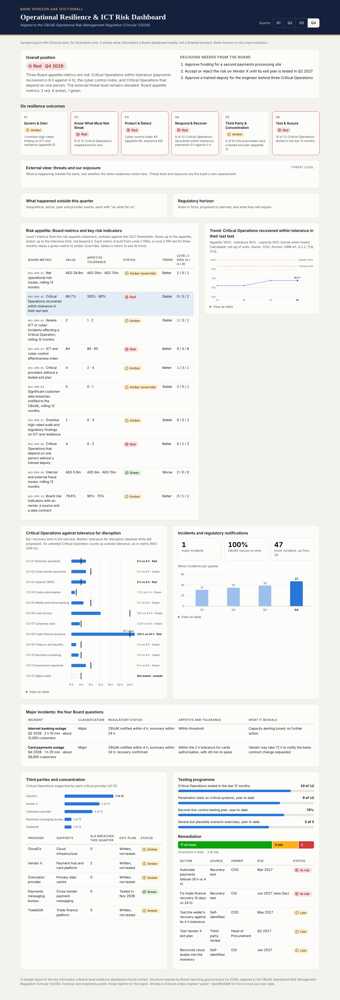

# Resilience Board Dashboard (sample)

A sample Board-level dashboard for **operational resilience and ICT risk** at a bank, aligned to the **CBUAE Operational Risk Management Regulation (Circular 1/2026)**. It turns the questions a Board must be able to answer into one interactive page.

**Live demo:** https://dalhamouieh-web.github.io/resilience-board-dashboard/
> All data is fictional. *Bank Horizon UAE* is not a real institution, and every figure is dummy data for illustration.



## Objectives

- Show what a decision-ready Board report on resilience looks like: decisions first, every number against an approved threshold.
- Translate regulatory requirements (CBUAE 1/2026, with DORA as the European reference) into measurable indicators.
- Provide a reusable template that anyone can load with their own data.

## What the dashboard shows

| Panel | Board question it answers | Regulatory anchor (CBUAE 1/2026) |
| --- | --- | --- |
| Overall position and decisions | Where do we stand, and what must we decide? | Board approval of appetite and tolerance |
| Six resilience outcomes | Is each part of resilience green, amber or red? Each status is the worst of the risk appetite metrics behind it | Operational risk framework and resilience strategy |
| **External view: threats and our exposure** (new) | What is happening outside, and do we have the same weakness? | Internal and external indicators; emerging risks |
| **External events and regulatory horizon** (new) | Which outside events and rule changes matter for us this quarter? | Relevant external events and regulatory changes |
| Risk appetite: Board metrics and KRIs, with trend | Are we within appetite, and which way are we moving? | Appetite, tolerance and limits (art. 1.25 to 1.27, 4.2); thresholds and reporting (art. 2.5.5, 7.11) |
| Critical Operations vs tolerance | Can we recover our most important services in time? | Critical Operations mapping and tolerance for disruption |
| Incidents and notifications | What went wrong, and did we tell the regulator on time? | Notices within 4 h, 24 h and 72 h |
| Major incidents: four questions | Classification, regulatory status, appetite, what it reveals | Incident management |
| Third parties and concentration | Who do we depend on, and could we replace them? | Third-party strategy, non-objection, exit plans |
| Testing programme | Have we tested what matters this year? | BCP and DR testing, stress tests |
| Remediation | Are we fixing what we found, on time? | Annual report on internal control |

**Interactivity:** a quarter filter (Q1 to Q4), selectable indicators with a trend chart, hover tooltips on every chart, a "View as table" option for each chart, and automatic light and dark mode.

## Dataset

Fictional quarterly data for 2026, provided in two formats:

- `data/dashboard-data.js`: the file the dashboard reads
- `data/csv/*.csv`: the same data as CSV, for Excel, Power BI or other tools

| File | Contents |
| --- | --- |
| `kri_history.csv` | The 10 Board risk appetite metrics (Level 1) by quarter, with target, appetite, tolerance and capacity, calculation method, owner, Level 2 KRI status and any override |
| `threat_level.csv` | External threat level by quarter, with its main driver |
| `external_threats.csv` | Top external threats, whether the same weakness exists here, actions and owners |
| `external_events.csv` | Geopolitical, sector, peer and provider events by quarter, with "so what for us" |
| `regulatory_horizon.csv` | Rules in force, proposed or planned, and what they require |
| `outcomes.csv` | Status of the six resilience outcomes by quarter, the metrics that drive each one, and the note shown |
| `controls.csv` | The 30 key controls behind the six outcomes: owner, frequency, evidence, the KRI each feeds, the rule it meets, the newsletter edition and deliverable that explain it, and the test result by quarter |
| `critical_operations.csv` | Tolerance for disruption vs latest tested recovery time |
| `incidents.csv` | Major and minor incidents and notification timeliness by quarter |
| `major_incidents.csv` | Major incidents framed by the four Board questions |
| `third_parties.csv` | Critical providers, concentration, SLAs and exit plans |
| `testing.csv` | Testing programme progress |
| `remediation.csv` | Late and at-risk remediation actions |

## What is behind each outcome

Select any of the six outcome cards to open what is behind it: the question it answers, the metrics that set its colour and why, the five key controls that drive those metrics (owner, frequency, evidence, test result), the newsletter editions that explain it, the deliverables that build it, and the rule it meets. A red outcome always has at least one ineffective control behind it, so the colour can be traced from the Board page down to evidence.

## Key insights (sample data, Q4 2026)

- **The external threat level is elevated:** identity-based intrusion, control-first ransomware and wipers, persistent DDoS and AI-accelerated attacks are rising; the bank has the same weakness, at least partly, for five of six.
- **Three of ten Board appetite metrics are red:** only 8 of 12 Critical Operations can show they recover within tolerance (domestic payments took 6 hours against 4); the cyber control index is 64, below its tolerance of 65; and four Critical Operations still depend on one person.
- **Two green metrics are reported amber by the override rule:** operational losses look low, but loss events are recorded late; no data breach was notified, but critical data is not yet fully classified.
- **Concentration:** one provider supports 7 of 12 Critical Operations, and 4 of 9 critical providers lack a tested exit plan.
- **Notifications:** 100% of regulatory notifications were made on time throughout the year.
- **The wallet went live in December** without an approved tolerance for disruption or a recovery test, so it counts as outside tolerance.
- **Every panel follows the selected quarter, and the numbers agree:** the Critical Operations chart, the testing programme, the third-party table, the six outcomes and the Board metrics all come from the same data.

## Tools

Plain HTML, CSS and JavaScript, with hand-drawn SVG charts. No framework, no build step and no external dependencies, so it runs anywhere and deploys free on GitHub Pages.

## Run it locally

Open `index.html` in any browser. That's it.

## Deploy on GitHub Pages

1. Create a new repository named `resilience-board-dashboard` and upload these files (or push them with git).
2. In the repository, go to **Settings > Pages**.
3. Under **Build and deployment**, choose **Deploy from a branch**, select `main` and `/ (root)`, then **Save**.
4. After a minute, the dashboard is live at `https://<your-github-username>.github.io/resilience-board-dashboard/`.

## Use your own data

Edit `data/dashboard-data.js`. Each block is commented: change the values, thresholds, names or quarters, and refresh the page. Statuses for the risk appetite metrics are calculated automatically from the `appetite`, `tolerance` and `capacity` thresholds: for `direction: "up"`, higher is worse; for `"down"`, lower is worse. Set `override` for a quarter to the ID of a Level 2 KRI that has been red for three months to report a green metric as amber.

## Files in this repository

```
index.html               the dashboard page
style.css                styles, including light and dark themes
app.js                   rendering, charts, tooltips and filters
dashboard-data.js        sample data the page reads
*.csv                    the same sample data as CSV files
dashboard-preview.png    screenshot used in this README
```

## How the risk appetite panel works

The panel follows the risk appetite framework published with *The Resilience Bridge* (policy, procedure, statement and metrics workbook for the fictional Bank Horizon):

- **Level 1 metrics** are the Board's appetite metrics. Each has four thresholds: **target**, **appetite**, **tolerance limit** and **capacity**. Green up to the appetite, amber up to the tolerance limit, red beyond it, "beyond capacity" past the capacity point. Status is calculated, never typed.
- **Level 2 KRIs** are built from what the operational teams already measure and explain each Level 1 metric. The panel shows how many are green, amber and red.
- **Calculation method:** each Level 1 metric is either measured directly, rolled up from units (for example, the share of Critical Operations within tolerance) or a weighted composite index (the cyber control index).
- **Override:** if a Level 2 KRI has been red for three months, a green Level 1 metric is reported amber, so an average or a lagging count cannot hide a serious problem.
- Quarters are restated against the 2027 thresholds, so the trend is comparable.

## About the external view

The CBUAE expects Board reporting to use internal and external indicators and to cover emerging risks, relevant external events and regulatory changes. The external view shows one way to do it: each outside threat or event is paired with the bank's own answer to "do we have the same weakness?", an action and an owner. The threat themes are inspired by public threat reporting for the UAE and the region, such as Help AG's *State of the Market Report 2026*. Items marked "public" refer to publicly reported events; items marked "illustrative" are invented; all assessments are fictional.

## Roadmap

- Add an onshore vs free-zone view (CBUAE, DFSA and FSRA) for groups with several regulated entities
- Load data directly from CSV files
- Add a printable one-page Board report view
- Add a risk-appetite heatmap across business lines

## About

Built by **Dima Alhamouieh** as part of *The Resilience Bridge*, a series on bringing lessons from Europe's DORA to resilience in the Gulf, onshore and free zone.

## License

MIT. See `LICENSE`.
